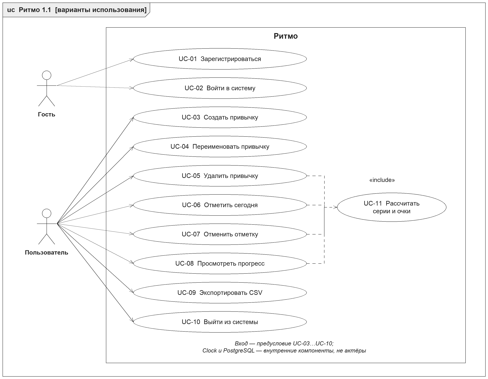
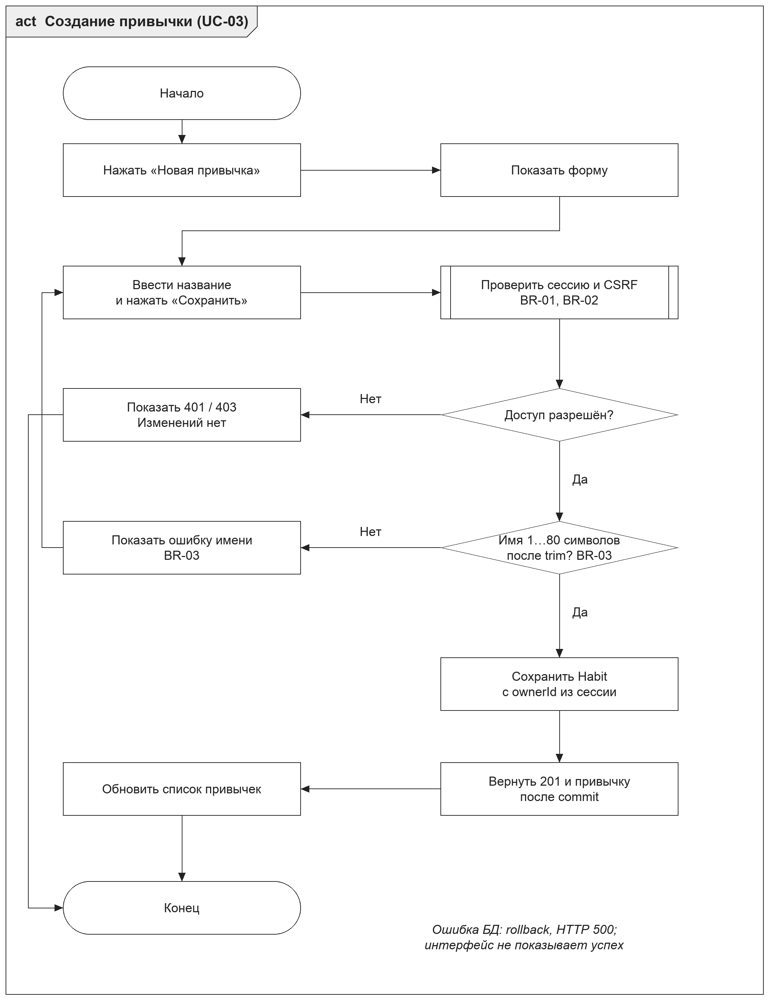
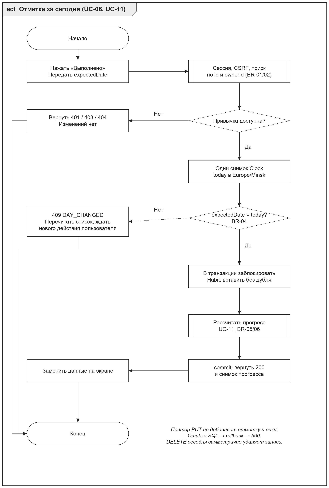
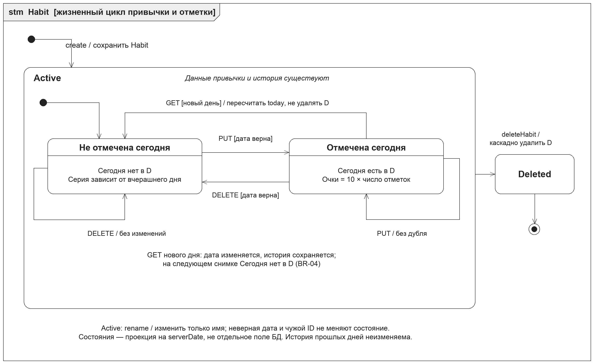
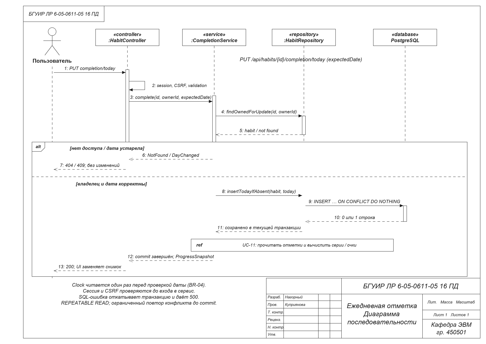

# Описание проектирования Ритмо

SDD 1.2, 16.11.2026. Автор: Нагорный Глеб Дмитриевич, группа 450501.

## 1 Введение

### 1.1 Назначение

Документ задаёт предписывающее проектирование будущего приложения, достаточное для разработки Java-сервера и React-клиента. Основание — SRS 0.2 из `lab3` и системные требования 1.1 из отчёта ЛР4. Реализован отдельный доменный прототип Java; сервер, React и PostgreSQL ещё не реализованы.

### 1.2 Область применения

Один локальный экземпляр приложения, одна БД, браузер Chrome. Система регистрирует пользователя, ведёт ежедневные привычки и отметки, считает серии и очки, выгружает CSV. Значок вынесен в следующий выпуск CR-01. Напоминания и внешние сервисы исключены.

### 1.3 Термины

SRS — спецификация требований; SDD — описание проектирования; ADR — запись архитектурного решения; DTO — объект обмена; Clock — внедряемый источник времени; транзакция — атомарная группа операций БД. Senior — основной разработчик, junior — дополнительный начинающий разработчик.

### 1.4 Ссылки

[Материалы ЛР5](../README.md), [исходный SDD 1.1](../../design/ritmo-sdd.md), [приёмка](../../verification/acceptance.md). Требования и план V3 приведены в отчёте ЛР4.

### 1.5 Обзор

Раздел 2 определяет заинтересованные стороны и точки зрения, раздел 3 содержит проектные представления с уникальными ID, раздел 4 связывает их с ADR, раздел 5 фиксирует ограничения и изменения.

## 2 Обзор проектирования

### 2.1 Задачи заинтересованных сторон

| Участник | Интерес | Решение и доказательство |
|---|---|---|
| Пользователь | Данные не теряются и не видны другим | VIEW-02/03, AT-08/09 |
| Условный заказчик | Полезные функции к фиксированной дате | V3, CR-01, ADR-004 |
| Разработчик | Небольшая сложность, определённые API | VIEW-01/03, ADR-001 |
| Проверяющий | Однозначные правила и трассировка | Реестр требований, AT-01…13 |

### 2.2 Выбранные точки зрения

Контекст и композиция (VIEW-01): границы, компоненты и коннекторы. Информация (VIEW-02): сущности, ограничения и жизненный цикл. Интерфейс и взаимодействие (VIEW-03): HTTP API, сессия, ошибки и последовательности. Алгоритмы, состояния и параллелизм (VIEW-04): дата, идемпотентность, расчёт прогресса. Развёртывание и ресурсы (VIEW-05): локальные процессы, зависимости и хранение. Паттерны и зависимости описаны внутри VIEW-01. Самостоятельные аппаратные и распределённые представления не нужны: специальных устройств и кластера нет.

## 3 Проектные представления

### VIEW-01 Контекст и композиция

**Viewpoint:** Context, Composition, Dependency. **Требования:** все исходные; ADR-001.

Браузер пользователя → React UI → HTTP/JSON API Java → PostgreSQL. Только Java обращается к БД. CSV возвращается тем же API; внешние интеграции отсутствуют.

Java-приложение — модульный монолит: AuthController/AuthService, HabitController/HabitService, CompletionService, ProgressService и ExportService; репозитории инкапсулируют SQL. Зависимости направлены Controller → Service → Repository. Контроллер проверяет формат, сервис выполняет бизнес-правила и проверку владельца, репозиторий сохраняет данные. Общие компоненты — Clock, обработчик ошибок и модуль безопасности. React использует компоненты LoginForm, HabitList, HabitForm, ProgressSummary, ExportForm и один API client; источник истины — сервер.

Предполагаемый стек: JDK 21, Spring Boot 3.x, Spring Security, Spring Data JPA, PostgreSQL 16; React 18, TypeScript, Vite, Node 22. Это проектный выбор, точные patch-версии фиксируются в сборке при реализации; их совместимость ещё не проверена запуском.

### VIEW-02 Информационная модель

**Viewpoint:** Information. **Требования:** REQ-FUNC-001/003/004/005, REQ-REL-001; ADR-002.

| Таблица | Поля | Ограничения |
|---|---|---|
| app_user | id UUID, login varchar(64), password_hash text | PK id; UNIQUE login; NOT NULL |
| habit | id UUID, owner_id UUID, name varchar(80), created_at timestamptz | FK owner_id → app_user; NOT NULL; trim name 1…80 |
| completion | habit_id UUID, completion_date date | PK(habit_id, completion_date); FK → habit ON DELETE CASCADE |

Связи: app_user 1:N habit; habit 1:N completion. Индекс habit(owner_id); составной PK completion поддерживает просмотр отметок привычки. Очки, серия, значок не хранятся как независимые поля: вычисляются из отметок, поэтому отмена и удаление не оставляют устаревшие награды. Пароли хранятся только в виде salted adaptive hash. Сессионные данные хранятся сервером в памяти; после перезапуска потребуется вход, но учётные записи и прогресс сохраняются.

Удаление владельца в пользовательском интерфейсе не предусмотрено. Создание и переименование проверяют Unicode code points после trim; пустая строка и >80 символов отклоняются. Уточнение аутентификации: логин 3…64 ASCII символа `[A-Za-z0-9_]`, регистр значим, пароль 8…64 символа; сервер возвращает 400 при нарушении. Это проектные ограничения, а не исходные параметры SRS.

### VIEW-03 Интерфейсы и взаимодействия

**Viewpoint:** Interface, Interaction. **Требования:** REQ-FUNC-001/003/004/005/009, REQ-SEC-001, SYS-01/03/04; ADR-003.

API prefix `/api`, JSON UTF-8, кроме экспорта. GET `/csrf` выдаёт CSRF-токен для последующих изменений, в том числе входа и регистрации. Браузер отправляет его в заголовке `X-CSRF-TOKEN`.

| Метод и путь | Вход | Успех |
|---|---|---|
| POST /auth/register | login, password | 201; дубликат — 409 |
| POST /auth/login | login, password | 200 и новая сессия; неверные данные — 401 |
| POST /auth/logout | CSRF | 204, сессия уничтожена |
| GET /habits | нет | 200: serverDate, habits[id,name,completedToday,streak], totalPoints |
| POST /habits | name | 201: созданная привычка |
| PATCH /habits/{id} | name | 200: обновлённая привычка |
| DELETE /habits/{id} | нет | 204; подтверждение запрашивается в UI |
| PUT /habits/{id}/completion/today | expectedDate | 200: актуальный список и прогресс; повтор идемпотентен |
| DELETE /habits/{id}/completion/today?expectedDate=… | дата ISO | 200: актуальный список и прогресс; повтор идемпотентен |
| GET /progress/export?from=…&to=… | даты ISO | 200: CSV по REQ-FUNC-009 |

Тело JSON-ошибки: `{code,message,fieldErrors}`. 400 — формат/валидация; 401 — нет сессии; 403 — неверный CSRF; 404 — объект отсутствует или чужой; 409 — LOGIN_EXISTS либо DAY_CHANGED; 500 — непредвиденная ошибка без внутреннего стека в ответе. Все API-ответы личных данных используют Cache-Control: no-store. Ошибка SQL не считается успешным сохранением.

Последовательность отметки: UI отправляет expectedDate → фильтр сессии/CSRF → поиск привычки по id и owner_id → Clock даёт serverDate → проверка даты → транзакция с блокировкой строки habit → вставка без дубликатов либо удаление → чтение согласованного прогресса → commit → ответ → UI заменяет локальные данные. При 409 DAY_CHANGED клиент перечитывает список и просит повторить действие. Произвольная дата записи не принимается. Чужой id всегда даёт 404 и ничего не меняет.

Экспорт: сессия → валидация диапазона → один запрос JOIN completion/habit с owner_id из сессии → экранирование CSV и обезвреживание формул → ответ-вложение. Одно SQL-чтение даёт согласованный снимок; пользователь не передаёт owner_id. После удаления привычки новая выгрузка не включает её отметки. Ограничение диапазона — 366 дней, массовая выгрузка не входит в MVP.

### VIEW-04 Алгоритмы состояния и конкуренция

**Viewpoint:** Algorithm, State Dynamics, Concurrency. **Требования:** REQ-FUNC-004…008, SYS-02/03; ADR-002.

Для одного запроса `today = LocalDate.now(clock.withZone(Europe/Minsk))` вычисляется ровно один раз. Пусть D — множество дат отметок привычки. `anchor = today`, если today ∈ D, иначе today − 1 день. Начиная с anchor, пока дата принадлежит D, прибавлять 1 и переходить на предыдущий день. Счётчик — текущая серия. Если anchor отсутствует, результат 0. Очки пользователя — `10 * COUNT(completion JOIN habit WHERE owner_id = session.userId)`.

Проверочные примеры: вчера+сегодня → 2; вчера и позавчера без сегодня → 2; только позавчера → 0; только сегодня → 1; семь последовательных дней → 7, после отмены сегодня → 6. Для отложенного значка правило `streak >= 7`; в выпуске V3 значок не отображается вообще.

Состояния отметки: отсутствует → PUT → существует; существует → PUT → существует; существует → DELETE → отсутствует; отсутствует → DELETE → отсутствует. История за прошлые даты через публичный API неизменяема. Переименование не меняет отметки. Удаление привычки — конечное состояние для её ID.

Уникальный PK предотвращает параллельные дубли. Запись блокирует строку habit (`SELECT … FOR UPDATE`) до изменения/пересчёта; удаление получает ту же блокировку. Снимок чтения прогресса внутри операции согласован транзакцией REPEATABLE READ; конфликт сериализации откатывается целиком и допускает ограниченный повтор до commit. При разных вкладках последняя зафиксированная PUT/DELETE определяет состояние; экран получает новое состояние при следующем запросе. Ответ отражает снимок конкретной операции; следующая параллельная операция может его изменить. Никакие очки не начисляются отдельным побочным событием.

### VIEW-05 Развёртывание и ресурсы

**Viewpoint:** Deployment, Resources. **Требования:** REQ-REL-001, REQ-INST-001; ADR-001.

Один компьютер: Chrome → `localhost:5173` (React dev server, proxy `/api`) → `127.0.0.1:8080` (Java) → `127.0.0.1:5432` (PostgreSQL). Браузер работает через один origin, wildcard CORS не используется. Диск БД постоянный. Миграции схемы выполняются до запуска API; секреты БД — переменные окружения. В локальной конфигурации Secure-cookie выключен только для HTTP loopback, HttpOnly и SameSite=Lax включены; при будущем HTTPS Secure обязателен.

Предполагаемые команды будущей реализации: создание БД `ritmo`; `./mvnw spring-boot:run` в server; `npm ci` и `npm run dev` в client. Эти команды являются контрактом будущей инструкции, сейчас доступны исходники доменного прототипа, без этих серверных команд. Пул соединений ограничен 5, один экземпляр API. Целевое окружение демонстрации: 4 CPU, 8 GB RAM; нагрузочное подтверждение этой оценки не проводилось. Логи содержат код ошибки и ID запроса, но не пароли, cookies и CSV.

## 4 Решения

| ID | Контекст и варианты | Итог и связь |
|---|---|---|
| ADR-001 | Монолит или микросервисы; PostgreSQL или embedded БД | Модульный монолит + PostgreSQL; VIEW-01/02/05 |
| ADR-002 | Счётчики или вычисление из отметок | Производные значения на чтении, атомарные операции; VIEW-02/04 |
| ADR-003 | Сессия или JWT | Серверная сессия, owner-filter, CSRF; VIEW-03 |
| ADR-004 | Перенос даты, сокращение объёма, junior | CSV вместо значка + junior, V3; VIEW-03/04 |

Полные записи: [ADR-001](../../decisions/ADR-001-monolith.md), [ADR-002](../../decisions/ADR-002-consistency.md), [ADR-003](../../decisions/ADR-003-session.md), [ADR-004](../../decisions/ADR-004-release.md).

## 5 Приложения и изменения

Трассировка и критерии — в реестре требований, сроки — в V0–V3, сценарии проверки — в AT-01…13. Версия 1.0 описывала исходный состав со значком; версия 1.1 добавляет ExportService и API CSV, переносит значок и отражает CR-01. Проектирование не требует изменений модели БД для экспорта. Если появится массовая нагрузка, пересмотреть вычисления прогресса и ограничения выгрузки; до измерений кеширование не вводится.

## 6 Динамическая модель ЛР5

Новая редакция 1.2 дополняет исходную 1.1; старый файл сохранён согласно условию добавлять только новые файлы.
Термины: [глоссарий](../uml/glossary.md). Общие ограничения: [дополнительные спецификации](../uml/supplementary-specification.md).
Описание всех актёров и сценариев: [модель прецедентов](../uml/use-case-model.md).

### VIEW-06 Варианты использования

Гость инициирует регистрацию и вход; Пользователь — личные операции.
UC-05/06/07/08 обязательно включают UC-11. Вход — предусловие, поэтому повторной аутентификации при каждом действии на диаграмме нет.
Clock и БД — элементы системы, а не актёры. Значок и внешние уведомления отложены.

### VIEW-07 Потоки активности

UC-03 проверяет доступ и имя до сохранения; ошибка имени возвращает к вводу.
Успех отображается только после commit. 401/403 и SQL-ошибка не создают привычку.

UC-06 проверяет владельца, затем единую дату, сохраняет идемпотентно и пересчитывает прогресс.
409 требует перечитывания и нового действия пользователя. UC-07 использует ту же проверку и блокировку, но удаляет дату.
Визуальные символы ГОСТ соответствуют примеру отчёта; исходники PlantUML передают ту же семантику стандартными узлами активности.

### VIEW-08 Жизненный цикл Habit

Active содержит состояния относительно serverDate: «Не отмечена сегодня» и «Отмечена сегодня».
При создании история пуста. PUT/DELETE переключают представление только при совпадении даты.
Повторы — самопереходы. GET нового дня меняет проекцию без изменения истории.
Deleted — конец жизни ID после каскадного удаления. Переименование сохраняет историю.

### VIEW-09 Взаимодействие ежедневной отметки

HabitController проверяет сессию и CSRF; CompletionService управляет проверкой даты и атомарной операцией;
HabitRepository блокирует Habit и выполняет SQL, PostgreSQL обеспечивает уникальность пары.
Перед проверкой даты сервис читает Clock один раз. ref UC-11 обозначает чтение и вычисление прогресса внутри той же транзакции.
Возврат 200 допустим только после commit; ошибка БД вызывает rollback и 500.
Ветка 404/409 завершается без записи. На листе А3 сохранены рамка и основная надпись образца.

### Трассировка и статус реализации

| Прецедент | Представление | Требования | Проверка |
|---|---|---|---|
| UC-01/02/10 | VIEW-06 | REQ-FUNC-001 | AT-01/08 |
| UC-03/04/05 | VIEW-06/07/08 | REQ-FUNC-003/004 | AT-02/03 |
| UC-06/07/11 | VIEW-06/07/08/09 | REQ-FUNC-005/006/007 | AT-04…06/12 |
| UC-08 | VIEW-06/08 | REQ-FUNC-006/007 | AT-05/06/09 |
| UC-09 | VIEW-06 | REQ-FUNC-009 | AT-11 |

Доменный прототип: [исходник](../implementation/src/by/bsuir/ritmo/HabitService.java),
[проверки](../implementation/test/by/bsuir/ritmo/DomainChecks.java), [запуск и ограничения](../implementation/README.md).
Он не использует БД и HTTP: синхронизация Java демонстрирует сериализацию одного процесса, но не заменяет транзакции VIEW-04.
AT-01…13 полного приложения по-прежнему не выполнены; 23 проверки доменной логики и 100 конкурентных PUT выполнены отдельно.
Связь с ADR-001…004 и механизмы построения приведены в [ADR-005](../decisions/ADR-005-uml-behavior.md).
