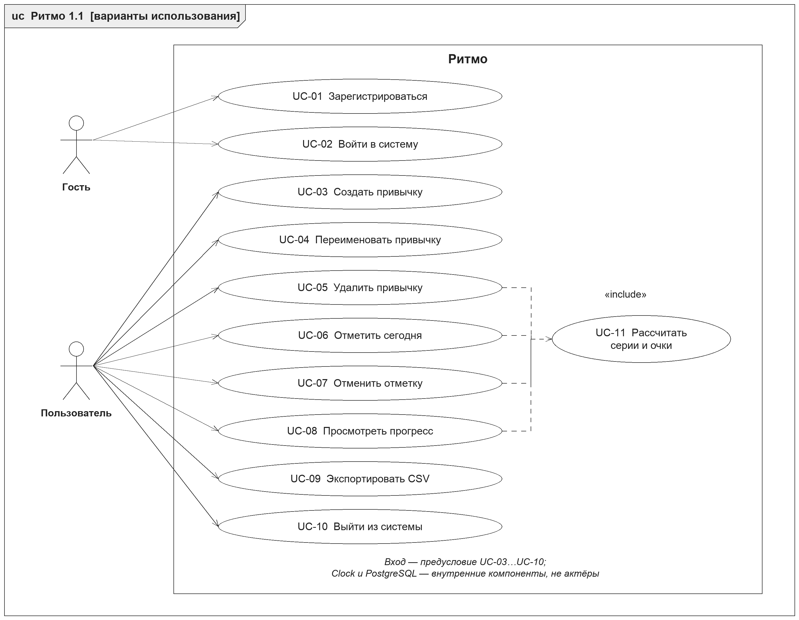

# Модель вариантов использования Ритмо

Версия 1.0, 16.11.2026. Выпуск V3: CSV включён, значок отложен.

## Актёры

| Актёр | Роль |
|---|---|
| Гость | Не вошедший посетитель. Создаёт учётную запись и получает сессию. |
| Пользователь | Владелец сессии. Управляет личными привычками, просматривает и выгружает прогресс. |

Clock, Java и БД находятся внутри системы; внешних интеграций нет.

UC-05/06/07/08 включают UC-11. Вход является предусловием защищённых действий, а не обязательным повторным вызовом. extend и обобщение без предметной необходимости не вводятся.

## UC-01 Зарегистрироваться

**Актёр:** Гость.

**Описание:** Создать личную учётную запись.

**Основание:** REQ-FUNC-001; AT-01.

**Предусловия:** Открыта форма регистрации; сессия не требуется.

**Основной поток:**

1. Ввести логин и пароль.
2. Клиент получает CSRF и отправляет POST /api/auth/register.
3. Сервер проверяет логин 3…64 ASCII-символа [A-Za-z0-9_] и пароль 8…64 символа.
4. Сервер проверяет уникальность логина, сохраняет хеш и возвращает 201.
5. Интерфейс предлагает войти.

**Альтернативные потоки и ошибки:**

- А1: неверный формат — 400 и ошибки у полей; данные не сохраняются.
- А2: логин занят — 409 LOGIN_EXISTS; выбрать другой логин.
- Е1: ошибка БД — rollback и 500; успех не показывается.

**Постусловия:** Учётная запись создана; вход выполняется отдельно в UC-02.

## UC-02 Войти в систему

**Актёр:** Гость.

**Описание:** Получить сессию для доступа к личным данным.

**Основание:** REQ-FUNC-001; REQ-SEC-001; AT-01/08.

**Предусловия:** Учётная запись существует; открыта форма входа.

**Основной поток:**

1. Ввести логин и пароль.
2. Получить CSRF и отправить POST /api/auth/login.
3. Сервер проверяет учётные данные.
4. Сервер обновляет идентификатор сессии и возвращает 200 с cookie.
5. Интерфейс открывает личный список через UC-08.

**Альтернативные потоки и ошибки:**

- А1: неверные учётные данные — 401, форма остаётся открытой.
- А2: отсутствует или неверен CSRF — 403; обновить токен.
- Е1: сеть или сервер недоступны — понятная ошибка, доступ не считается полученным.

**Постусловия:** Создана новая сессия; пароль и cookie не попадают в логи.

## UC-03 Создать привычку

**Актёр:** Пользователь.

**Описание:** Добавить собственную ежедневную привычку.

**Основание:** REQ-FUNC-003; AT-02.

**Предусловия:** Есть действующая сессия и CSRF.

**Основной поток:**

1. Нажать «Новая привычка».
2. Ввести название и отправить POST /api/habits.
3. Сервер проверяет BR-01…03.
4. Сервис присваивает ownerId из сессии, сохраняет Habit в транзакции.
5. После commit сервер возвращает 201; клиент добавляет привычку в список.

**Альтернативные потоки и ошибки:**

- А1: пустое или слишком длинное имя — 400, исправить поле.
- А2: нет сессии или CSRF — 401/403; запись не создаётся.
- Е1: ошибка сохранения — rollback и 500; форма сохраняет введённое имя.

**Постусловия:** Создана Habit без отметок; серия 0, очки не изменились.

## UC-04 Переименовать привычку

**Актёр:** Пользователь.

**Описание:** Изменить название, сохранив ID и историю.

**Основание:** REQ-FUNC-004; AT-03.

**Предусловия:** Собственная привычка существует; сессия и CSRF действительны.

**Основной поток:**

1. Открыть редактирование привычки.
2. Ввести новое имя и отправить PATCH /api/habits/{id}.
3. Сервер ищет по id и ownerId, проверяет BR-03.
4. Сервис изменяет только name; после commit возвращает 200.
5. Интерфейс показывает новое название.

**Альтернативные потоки и ошибки:**

- А1: неверное имя — 400; старое имя остаётся.
- А2: чужой или удалённый ID — 404.
- Е1: ошибка БД — rollback и 500.

**Постусловия:** Название изменено; отметки, серии и очки сохранены.

## UC-05 Удалить привычку

**Актёр:** Пользователь.

**Описание:** Удалить привычку и связанные отметки.

**Основание:** REQ-FUNC-004/007; AT-03/06/12.

**Предусловия:** Собственная привычка существует; сессия и CSRF действительны.

**Основной поток:**

1. Нажать «Удалить» и подтвердить действие.
2. Отправить DELETE /api/habits/{id}.
3. Сервис проверяет владельца и блокирует Habit.
4. В транзакции удалить Habit и её отметки; выполнить UC-11 для оценки результата.
5. После commit вернуть 204; клиент перечитывает UC-08.

**Альтернативные потоки и ошибки:**

- А1: отмена подтверждения — запрос не отправляется.
- А2: чужой или отсутствующий ID — 404.
- Е1: ошибка БД — rollback, все данные остаются.

**Постусловия:** Habit и её отметки удалены; очки учитывают оставшиеся записи.

## UC-06 Отметить сегодня

**Актёр:** Пользователь.

**Описание:** Зафиксировать выполнение привычки за текущий серверный день.

**Основание:** REQ-FUNC-005/006/007; SYS-02/03; AT-04…06/12.

**Предусловия:** Собственная привычка существует; известна serverDate; есть сессия и CSRF.

**Основной поток:**

1. Нажать «Выполнено».
2. Клиент отправляет PUT /api/habits/{id}/completion/today с expectedDate.
3. Сервер проверяет сессию, CSRF и владельца.
4. Сервис получает today один раз и сравнивает с expectedDate.
5. В транзакции блокирует Habit и вставляет дату без дубликата.
6. Выполняет UC-11 в согласованном снимке.
7. После commit возвращает 200 со списком и прогрессом; клиент заменяет данные.

**Альтернативные потоки и ошибки:**

- А1: повтор PUT — 200 с тем же эффектом; новых очков нет.
- А2: дата изменилась — 409 DAY_CHANGED; GET списка и новое действие пользователя.
- А3: нет доступа — 401/403/404 без изменения данных.
- Е1: SQL-ошибка — полный rollback и 500; конфликт сериализации допускает ограниченный повтор до commit.

**Постусловия:** Существует ровно одна отметка today; производные значения соответствуют снимку операции.

## UC-07 Отменить отметку

**Актёр:** Пользователь.

**Описание:** Удалить отметку только текущего серверного дня.

**Основание:** REQ-FUNC-005/006/007; AT-04…06.

**Предусловия:** Собственная привычка существует; известна serverDate; есть сессия и CSRF.

**Основной поток:**

1. Снять отметку выполнения.
2. Отправить DELETE /api/habits/{id}/completion/today с expectedDate.
3. Проверить доступ и дату как в UC-06.
4. В транзакции заблокировать Habit и удалить completion за today.
5. Выполнить UC-11; после commit вернуть 200 и заменить прогресс на экране.

**Альтернативные потоки и ошибки:**

- А1: записи уже нет — 200 без дополнительных изменений.
- А2: устаревшая дата — 409, перечитать список без автоматической отмены.
- А3: 401/403/404 — изменений нет.
- Е1: SQL-ошибка — rollback и 500.

**Постусловия:** Отметки today нет; прошлые даты сохранены; очки уменьшены только при фактическом удалении.

## UC-08 Просмотреть прогресс

**Актёр:** Пользователь.

**Описание:** Увидеть свои привычки, сегодняшние отметки, серии и очки.

**Основание:** REQ-FUNC-006/007; REQ-SEC-001; AT-05/06/08/09.

**Предусловия:** Действующая сессия.

**Основной поток:**

1. Открыть или обновить главный экран.
2. Клиент отправляет GET /api/habits.
3. Сервер получает today и выбирает только данные владельца.
4. Выполняет UC-11 в согласованном снимке.
5. Возвращает serverDate, habits и totalPoints; интерфейс отображает результат.

**Альтернативные потоки и ошибки:**

- А1: привычек нет — пустой список и 0 очков.
- А2: сессия закончилась — 401, открыть вход.
- А3: начался новый день — показать новые completedToday и серии, не изменяя историю.
- Е1: ошибка загрузки — сообщение и возможность повторить.

**Постусловия:** Отображён снимок личных данных; записи БД не изменены.

## UC-09 Экспортировать CSV

**Актёр:** Пользователь.

**Описание:** Скачать личные отметки за выбранный диапазон.

**Основание:** REQ-FUNC-009; AT-11.

**Предусловия:** Действующая сессия; открыта форма экспорта.

**Основной поток:**

1. Выбрать from и to и нажать «Скачать».
2. Отправить GET /api/progress/export с параметрами from и to.
3. Сервер проверяет BR-08.
4. Один JOIN-запрос читает completion и habit только владельца.
5. Сервер формирует CSV по BR-09 и возвращает файл-вложение.

**Альтернативные потоки и ошибки:**

- А1: неверные даты, будущая дата или более 366 дней — 400.
- А2: нет отметок — файл с BOM и заголовком.
- А3: нет сессии — 401.
- Е1: ошибка сервера — файл не считается полученным; показать сообщение.

**Постусловия:** CSV содержит только доступные отметки; состояние приложения не изменилось.

## UC-10 Выйти из системы

**Актёр:** Пользователь.

**Описание:** Прекратить доступ через текущую сессию.

**Основание:** REQ-FUNC-001; AT-01.

**Предусловия:** Есть действующая сессия и CSRF.

**Основной поток:**

1. Нажать «Выйти».
2. Отправить POST /api/auth/logout с CSRF.
3. Сервер уничтожает сессию и возвращает 204.
4. Клиент очищает личный экран и открывает форму входа.

**Альтернативные потоки и ошибки:**

- А1: сессия уже недействительна — 401; клиент скрывает личный экран.
- А2: неверный CSRF — 403; обновить токен и повторить по действию пользователя.
- Е1: обрыв сети — выход не объявляется подтверждённым сервером.

**Постусловия:** Прежняя сессия не даёт доступа; привычки и прогресс сохранены.

## UC-11 Рассчитать серии и очки

**Актёр:** Включаемый фрагмент.

**Описание:** Вычислить производный прогресс без отдельных счётчиков.

**Основание:** REQ-FUNC-006/007; ADR-002; AT-05/06.

**Предусловия:** Вызван из UC-05/06/07/08; известны ownerId и единая today; имеется согласованный снимок.

**Основной поток:**

1. Прочитать даты отметок существующих привычек владельца.
2. Для каждой привычки выбрать anchor: today при наличии отметки, иначе yesterday.
3. Считать подряд идущие даты назад до первого пропуска.
4. Вычислить totalPoints = 10 × число всех выбранных отметок.
5. Вернуть значения вызывающему прецеденту.

**Альтернативные потоки и ошибки:**

- А1: нет отметок — серия и очки 0.
- А2: есть вчера и позавчера, сегодня нет — серия 2.
- Е1: чтение не удалось — ошибка вызывающего прецедента; изменение не фиксируется.

**Постусловия:** Получен согласованный прогресс; дополнительных записей счётчиков нет.
